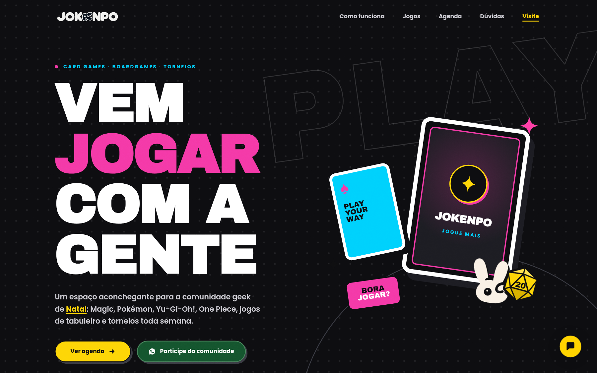
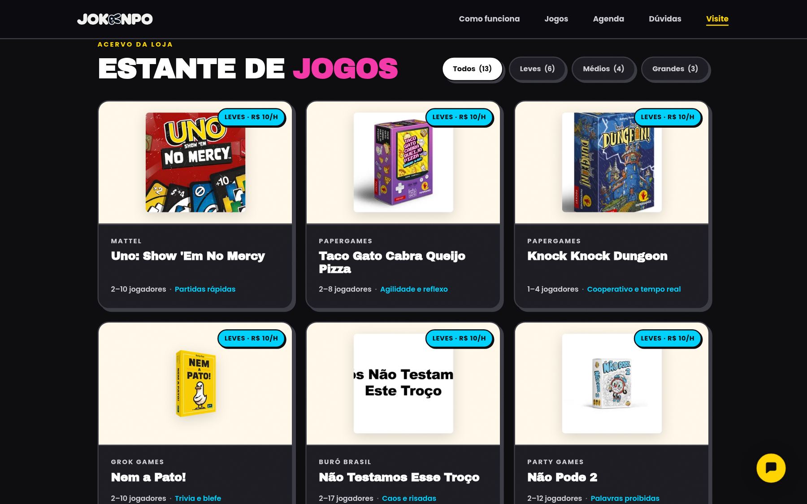

# Jokenpo Landing Page

Código da landing page oficial da [Jokenpo](https://jokenpo.cards), loja de card games, jogos de tabuleiro e torneios semanais no Shopping New Way Center (Pajuçara, Natal/RN). O projeto é construído com Astro 7, TypeScript estrito, CSS nativo, Decap CMS, integração com chatbot da Blip e deploy na Vercel.

## Prévia do site



| Estante de jogos com filtros por categoria | Agenda semanal em formato de ingressos |
|---|---|
|  |  |

<details>
<summary>Prévia mobile (390px)</summary>


</details>

## Chatbot com Blip

O atendimento automatizado no site usa o widget flutuante da plataforma Blip implementado em [src/components/BlipChatWidget.astro](src/components/BlipChatWidget.astro) e carregado pelo layout base em [src/layouts/BaseLayout.astro](src/layouts/BaseLayout.astro). O componente importa o pacote `blip-chat-widget` localmente, sem depender de CDN externa, e só inicializa após o evento `load` quando `PUBLIC_BLIP_APP_KEY` está preenchida. Sem a chave configurada, nenhum código do chat roda e o botão permanece oculto.

Visualmente, o lançador no canto inferior direito segue o estilo Arcade 2.0, com fundo amarelo (`#ffd400`), ícone e contorno em `#0e0e10`, sombra sólida deslocada e contador de notificações em rosa (`#ff3ea5`). Como o botão padrão da biblioteca usa uma `<div>`, o componente adiciona `role="button"`, `tabindex="0"`, abertura por `Enter` e `Space`, `aria-expanded` e `aria-label` atualizados pelos eventos `OnEnter` e `OnLeave`, além de suporte a `:focus-visible`, `prefers-reduced-motion` e `forced-colors: active`.

Para ativar o bot em desenvolvimento ou produção, preencha `PUBLIC_BLIP_APP_KEY` (obtida em `Canais > Blip Chat > Instalação` no portal da Blip), informe `PUBLIC_BLIP_COMMON_URL` se o contrato usar domínio dedicado e inclua `localhost` e `jokenpo.cards` na lista de domínios autorizados em `Canais > Blip Chat > Configurações`.

## Loja e integração com o PDV

O PDV da loja (repositório `jokenpo-pdv`) é o único lugar onde se edita a loja do site: quais produtos aparecem
(Cadastros → Site), nome de vitrine, descrição, destaque, fotos, preço, estoque, promoções e o acréscimo do cartão.
O site só mostra e recebe pedidos.

- **`/loja`**: uma seção por grupo de categoria do PDV, com sacola fixa no desktop e gaveta no celular (guardada no
  `localStorage`). Cartas avulsas aparecem como cartão de texto, com filtros por jogo, coleção, condição e idioma.
  Gerada sob demanda com cache de 60 s na CDN.
- **`/loja/<produto>`**: página de cada produto (fotos, preço no Pix e no cartão, estoque, descrição, JSON-LD
  `Product`), listada no `/sitemap.xml`.
- **Pedido**: a sacola pede nome e WhatsApp e cria o pedido, que fica **aguardando confirmação** até o PC da loja
  conferir o estoque (mesmo com o PC desligado na hora: ele aplica quando liga). Com estoque, a loja separa e o
  cliente tem 48 h para pagar por Pix no WhatsApp; sem estoque, o pedido é recusado. O cliente acompanha na sacola.
  Se o PC passar de 6 h sem contato, ou com `PEDIDOS_NO_SITE=false`, a sacola manda o pedido pelo WhatsApp.

O PC da loja só faz chamadas de saída (rotas `/api/pdv-sync/*`, assinadas com HMAC); o site guarda uma cópia do
catálogo e a fila de pedidos num Postgres (Neon) e as fotos no Vercel Blob. Operação do site:
[docs/plano-api-pdv.md](docs/plano-api-pdv.md). Protocolo completo: `docs/API-SITE.md` do `jokenpo-pdv`.

| Rota | Uso |
|---|---|
| `GET /api/pdv/estoque` | Disponível e preço por produto |
| `POST /api/pdv/pedidos` | Cria o pedido (`{ itens: [{ produtoId, quantidade }], nomeContato, telefoneContato }`) |
| `GET /api/pdv/pedidos/:id` | Status do pedido |
| `GET /api/pdv-sync/eventos`, `POST /api/pdv-sync/eventos/ack`, `POST /api/pdv-sync/estoque`, `POST /api/pdv-sync/foto` | Usadas pelo PC da loja (assinatura HMAC) |

## Decisões de projeto

### Acessibilidade

A página segue os critérios da WCAG 2.2 AA e funciona com navegação por teclado, leitor de tela e modo de alto contraste (`forced-colors: active`). O foco visível usa anel em `box-shadow` que acompanha o contorno dos botões, com `scroll-padding-top` no documento para o cabeçalho fixo não cobrir a seção de destino, além de link de salto para o conteúdo principal e fechamento do menu mobile por `Escape` ou clique externo.

Animações respeitam `prefers-reduced-motion: reduce`, e a faixa contínua de categorias em `src/components/Marquee.astro` oferece um botão para pausar ou retomar o movimento, pausando também ao receber foco ou ponteiro. Os accordions do FAQ usam `<details>` e `<summary>` nativos, os cartões de jogos são `<article>` não interativos fora da ordem de tabulação, e números decorativos de fundo ficam em pseudoelementos CSS (`::after`) para não interferir na árvore de acessibilidade.

### Identidade visual

O visual segue o guia da marca em [docs/style-guide.md](docs/style-guide.md) e as especificações registradas em [DESIGN.md](DESIGN.md). O layout usa propriedades CSS customizadas em `src/styles/global.css` e estilos com escopo por componente, sem bibliotecas externas de UI, combinando fundo escuro (`#0e0e10`), acentos em amarelo, ciano e rosa, bordas sólidas e sombras secas deslocadas.

### Ícones

Os ícones usam `astro-icon` com coleções Iconify instaladas como dependências de desenvolvimento: Lucide para setas e controles (mesma geometria de traço arredondado das peças da marca) e Simple Icons para logos de terceiros, como o WhatsApp. Tudo é resolvido em build e sai como SVG inline, sem JavaScript, fonte de ícones ou requisição extra. O modo sprite emite um `<symbol>` no primeiro uso de cada glifo e reutiliza com `<use>` nos demais.

Use sempre o componente `src/components/Icon.astro`. Ele marca o ícone como decorativo (`aria-hidden`) por padrão, aceita `label` quando o ícone for o único nome acessível do controle e `weight` para ajustar a espessura do traço (padrão `3.5`, via `--icon-stroke`). Para adicionar um glifo novo, inclua o nome em `include` no `astro.config.mjs`, o que mantém o bundle do servidor restrito aos ícones usados.

### Desempenho e descoberta por agentes

As rotas públicas (`/`, `/404`, `/admin` e `/llms.txt`) são pré-renderizadas em HTML estático; `/loja` é gerada sob demanda com cache curto na CDN, para mostrar o estoque de agora, enquanto o adaptador da Vercel mantém as rotas de autenticação e da API do PDV (`/api/pdv/*`, `/api/pdv-sync/*`) sob demanda. As capas dos jogos passam pelo pipeline de imagens do Astro (`astro:assets`), e as fontes `Archivo Black` e `Poppins` são empacotadas localmente via Fontsource com preload no `<head>`.

Os metadados incluem Open Graph, Twitter Cards, grafo JSON-LD (`WebSite`, `WebPage`, `GameStore`, `Event` e `FAQPage`), `/sitemap.xml` gerado (com a página de cada produto) e endpoint `/llms.txt` no formato do `llmstxt.org`. Cabeçalhos de cache e segurança ficam em `vercel.json`. Conforme registrado em [DESIGN.md](DESIGN.md), a página atingiu 100 em Acessibilidade, Boas Práticas, SEO e Agentic Browsing, e 98 em Performance no Lighthouse.

### Conteúdo e CMS

Horários, agenda semanal, passes de boardgame, catálogo de jogos, perguntas frequentes, textos da página `/loja` e
banners ficam em `src/data/site.json`, editados pelo Decap CMS em `/admin` (OAuth do GitHub, `astro-decap-cms-oauth`).
Os banners (coleção 6) giram em carrossel na página inicial e na `/loja`, com datas de início e fim conferidas também
no navegador. Produtos, fotos, preços e promoções não passam pelo CMS: são editados no PDV.

## Stack

- Astro 7 (`output: 'server'` com `@astrojs/vercel`) e TypeScript em modo estrito
- HTML e CSS nativos com tokens próprios e `@fontsource/archivo-black` e `@fontsource/poppins`
- `astro-icon` com Iconify (`@iconify-json/lucide` para UI e `@iconify-json/simple-icons` para marcas), resolvido em build via `src/components/Icon.astro`
- `blip-chat-widget` empacotado localmente para o chatbot flutuante da Blip
- Decap CMS (`/admin`) com `astro-decap-cms-oauth`

## Como rodar localmente

O projeto usa Node 24 (definido em `.nvmrc`) e `pnpm`.

```bash
nvm use
pnpm install
cp .env.example .env
vercel env pull .env.local   # banco e Blob de preview, para a /loja ter dados
pnpm dev
```

O servidor local abre por padrão em `http://localhost:4321`. Para rodar em background durante o desenvolvimento:

```bash
pnpm exec astro dev --background
pnpm exec astro dev status
pnpm exec astro dev logs
pnpm exec astro dev stop
```

Para validar tipos, testes e build de produção:

```bash
pnpm check   # inclui a conferência da cópia do contrato do PDV
pnpm test
pnpm build
```

O contrato da sincronização com o PDV (`src/lib/pdv/sync.ts` e `contract-fixtures/`) é copiado do repositório `jokenpo-pdv` com `pnpm sync:contract` e não deve ser editado aqui.

## Variáveis de ambiente

Consulte [.env.example](.env.example). Nunca versione chaves ou segredos reais no repositório.

| Variável | Uso | Obrigatória |
|---|---|---|
| `PUBLIC_SITE_URL` | URL canônica para SEO, Open Graph e JSON-LD | Não (padrão `https://jokenpo.cards`) |
| `OAUTH_GITHUB_CLIENT_ID` | Client ID do app OAuth para o Decap CMS | Apenas para usar `/admin` |
| `OAUTH_GITHUB_CLIENT_SECRET` | Secret do app OAuth para o Decap CMS | Apenas para usar `/admin` |
| `PUBLIC_BLIP_APP_KEY` | App Key do canal Blip Chat | Apenas para exibir o chat |
| `PUBLIC_BLIP_COMMON_URL` | URL dedicada do contrato no Blip, se houver | Não |
| `PEDIDOS_NO_SITE` | `false` manda o pedido só pelo WhatsApp (o catálogo continua); vale no próximo deploy | Não (padrão `true`) |
| `DATABASE_URL` | Postgres da ponte site ↔ PDV | Sim, para a `/loja` |
| `PDV_SYNC_TOKEN` | Segredo compartilhado com o PC da loja (`SITE_SYNC_TOKEN` no PDV) | Sim, para a sincronização |
| `BLOB_READ_WRITE_TOKEN` | Vercel Blob das fotos de produto enviadas pelo PDV | Sim (criada pela integração) |

Sem `OAUTH_GITHUB_CLIENT_ID` e `OAUTH_GITHUB_CLIENT_SECRET`, o OAuth fica desativado localmente. Enquanto `PUBLIC_BLIP_APP_KEY` estiver vazia, o botão do Blip Chat não é renderizado. Ao configurar o Blip, libere os domínios do site (`localhost` e `jokenpo.cards`) em `Canais > Blip Chat > Configurações` no portal da Blip.

## Estrutura do repositório

| Caminho | Responsabilidade |
|---|---|
| `src/pages/index.astro` | Composição das seções da landing page |
| `src/pages/loja.astro`, `src/scripts/loja.ts` | Vitrine de produtos (markup e estilos) e o comportamento no navegador: sacola, filtros, pedido e status |
| `src/pages/loja/[slug].astro` | Página de cada produto da vitrine (fotos, preço, estoque, descrição, dados da carta avulsa, JSON-LD `Product`) |
| `src/pages/sitemap.xml.ts` | Sitemap gerado com as páginas de produto do PDV |
| `src/components/PromoBanners.astro`, `src/lib/banners.ts` | Banners de eventos e promoções em carrossel |
| `src/pages/api/pdv/`, `src/pages/api/pdv-sync/` | API pública do PDV e rotas de sincronização do PC da loja |
| `src/lib/catalog.ts`, `src/lib/vitrine.ts`, `src/lib/pdv/` | Tipos e preços da vitrine, seções a partir do PDV, contrato `PdvClient` e ponte com o PDV (Postgres e Vercel Blob) |
| `db/migrations/` | Tabelas da ponte site ↔ PDV (aplicadas no build da Vercel; à mão: `pnpm db:migrate`) |
| `src/pages/admin.astro` | Painel do Decap CMS em `/admin` |
| `src/pages/llms.txt.ts` | Geração do arquivo `/llms.txt` a partir de `site.json` |
| `src/pages/404.astro` | Página de erro 404 |
| `src/layouts/BaseLayout.astro` | Metadados, SEO, JSON-LD, estrutura base e inclusão do chat |
| `src/components/` | Seções da página e componentes reutilizáveis (`Header`, `Hero`, `GamesSection`, `AgendaSection`, `BlipChatWidget` e demais seções) |
| `src/styles/` | Declarações `@font-face` (`fonts.css`) e tokens/estilos globais (`global.css`) |
| `src/data/site.json` | Fonte de dados pública exibida no site |
| `src/assets/games/` | Capas locais dos jogos otimizadas no build |
| `public/` | Vetores SVG da marca, `og-image.png`, `site.webmanifest`, `robots.txt` e configuração do CMS em `admin/` |
| `docs/` | Documentação da marca (`style-guide.md`, `brand-content.md`, `ui-ux-guidelines.md`) e capturas do site em `images/` |
| `vercel.json` | Cabeçalhos HTTP de segurança, cache e descoberta |

## Agentes

Para fluxos automatizados e regras de contribuição por agentes neste repositório, consulte [AGENTS.md](AGENTS.md).
