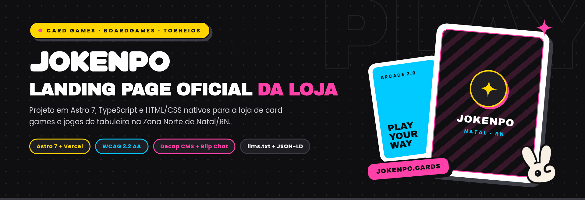
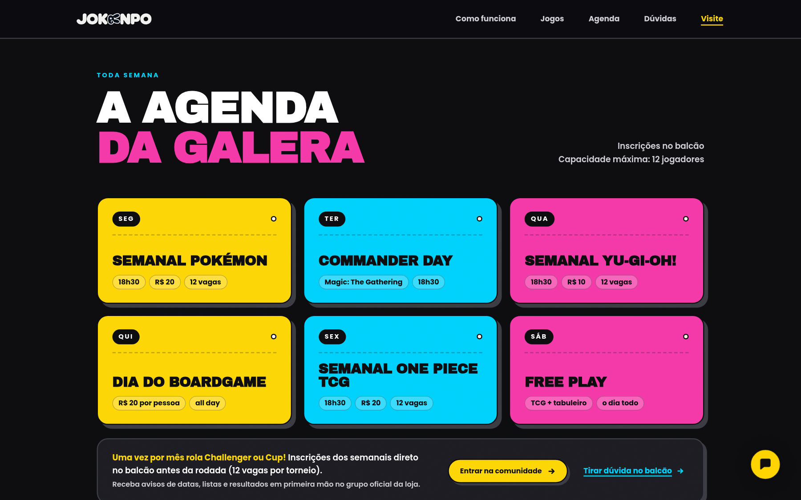

# Jokenpo Landing Page

Código da landing page oficial da [Jokenpo](https://jokenpo.cards), loja de card games, jogos de tabuleiro e torneios semanais no Shopping New Way Center (Pajuçara, Natal/RN). O projeto é construído com Astro 7, TypeScript estrito, CSS nativo, Decap CMS, integração com chatbot da Blip e deploy na Vercel.

## Prévia do site


| Estante de jogos com filtros por categoria | Agenda semanal em formato de ingressos |
|---|---|
|  |  |

<details>
<summary>Prévia mobile (390px)</summary>


</details>

## Chatbot com Blip

O atendimento automatizado no site usa o widget flutuante da plataforma Blip implementado em [src/components/BlipChatWidget.astro](src/components/BlipChatWidget.astro) e carregado pelo layout base em [src/layouts/BaseLayout.astro](src/layouts/BaseLayout.astro). O componente importa o pacote `blip-chat-widget` localmente, sem depender de CDN externa, e só inicializa após o evento `load` quando `PUBLIC_BLIP_APP_KEY` está preenchida. Sem a chave configurada, nenhum código do chat roda e o botão permanece oculto.

Visualmente, o lançador no canto inferior direito segue o estilo Arcade 2.0, com fundo amarelo (`#ffd400`), ícone e contorno em `#0e0e10`, sombra sólida deslocada e contador de notificações em rosa (`#ff3ea5`). Como o botão padrão da biblioteca usa uma `<div>`, o componente adiciona `role="button"`, `tabindex="0"`, abertura por `Enter` e `Space`, `aria-expanded` e `aria-label` atualizados pelos eventos `OnEnter` e `OnLeave`, além de suporte a `:focus-visible`, `prefers-reduced-motion` e `forced-colors: active`.

Para ativar o bot em desenvolvimento ou produção, preencha `PUBLIC_BLIP_APP_KEY` (obtida em `Canais > Blip Chat > Instalação` no portal da Blip), informe `PUBLIC_BLIP_COMMON_URL` se o contrato usar domínio dedicado e inclua `localhost` e `jokenpo.cards` na lista de domínios autorizados em `Canais > Blip Chat > Configurações`.

## Loja e integração com o PDV

A página `/loja` (antiga `/produtos`, que redireciona com 301) mostra shields, deck boxes e triple packs numa grade única ordenada por categoria (na ordem da lista no CMS), com um card por variação e filtro por categoria. O cliente monta a sacola e toca em **Enviar pedido no WhatsApp**: abre a conversa com a loja com itens, quantidades e total já escritos, para retirar no balcão. O site não pede nome nem telefone. A sacola fica fixa à direita no desktop e vira uma gaveta com barra inferior no celular. Ela guarda os itens no `localStorage` e deixa mudar a quantidade direto no card ou na sacola. Nomes de vitrine diferentes do PDV (ex.: "Deck box dupla" aparece como "Deck box completa") ficam em `labelOverrides`, no script de extração. Os dados vêm do banco do PDV (`comanda`) e ficam em `src/data/products.json`, gerado só com campos públicos (id, SKU, nome, preço e estoque). Para atualizar a partir de um novo dump:

```bash
pg_restore -f banco.sql banco.dump
node scripts/extract-products.mjs banco.sql
```

A integração com o PDV fica na interface `PdvClient` em `src/lib/pdv/`, com três modos em `PUBLIC_PDV_MODE`:

- `live`: PDV real. O PC da loja sincroniza com o site pelas rotas `/api/pdv-sync/*` (só chamadas de saída, assinadas com `PDV_SYNC_TOKEN`). O site guarda uma cópia do catálogo e a fila de pedidos num Postgres (`DATABASE_URL`, tabelas criadas no build da Vercel ou com `pnpm db:migrate`). O que aparece na vitrine é escolhido no PDV, em Cadastros → Site, e `/loja` é gerada sob demanda com cache de 60 s na CDN.
- `mock`: PDV simulado em memória, padrão no `pnpm dev`.
- `off`: sem PDV. A vitrine usa `products.json` e o pedido vai só pelo WhatsApp. É o padrão no build sem configuração.

Com PDV (`live` ou `mock`), a sacola pede nome e WhatsApp e cria o pedido. Ele fica **aguardando confirmação** até o PC da loja conferir o estoque, o que acontece mesmo se o pedido for feito com o PC desligado: ele é aplicado quando o PC liga. Se o PC passar de 6 h sem contato, a sacola volta a mandar o pedido pelo WhatsApp até ele voltar. Com estoque, a loja separa as unidades e o cliente tem 48 h para pagar por Pix no WhatsApp. Sem estoque, o pedido é recusado. O cliente acompanha o status na própria sacola. Operação do lado do site e passos para produção: [docs/plano-api-pdv.md](docs/plano-api-pdv.md). O protocolo completo fica em `docs/API-SITE.md` do repositório `jokenpo-pdv`.

| Rota | Uso |
|---|---|
| `GET /api/pdv/estoque` | Disponível e preço por produto |
| `POST /api/pdv/pedidos` | Cria o pedido (`{ itens: [{ produtoId, quantidade }], nomeContato, telefoneContato }`) |
| `GET /api/pdv/pedidos/:id` | Status do pedido |
| `POST /api/pdv/pedidos/:id/confirmar`, `.../cancelar` | Só no mock (rotas de balcão); no `live` isso é feito no PDV |
| `GET /api/pdv-sync/eventos`, `POST /api/pdv-sync/eventos/ack`, `POST /api/pdv-sync/estoque` | Usadas pelo PC da loja (assinatura HMAC) |

## Decisões de projeto

### Acessibilidade

A página segue os critérios da WCAG 2.2 AA e funciona com navegação por teclado, leitor de tela e modo de alto contraste (`forced-colors: active`). O foco visível usa anel em `box-shadow` que acompanha o contorno dos botões, com `scroll-padding-top` no documento para o cabeçalho fixo não cobrir a seção de destino, além de link de salto para o conteúdo principal e fechamento do menu mobile por `Escape` ou clique externo.

Animações respeitam `prefers-reduced-motion: reduce`, e a faixa contínua de categorias em `src/components/Marquee.astro` oferece um botão para pausar ou retomar o movimento, pausando também ao receber foco ou ponteiro. Os accordions do FAQ usam `<details>` e `<summary>` nativos, os cartões de jogos são `<article>` não interativos fora da ordem de tabulação, e números decorativos de fundo ficam em pseudoelementos CSS (`::after`) para não interferir na árvore de acessibilidade.

### Identidade visual

O visual segue o guia da marca em [docs/style-guide.md](docs/style-guide.md) e as especificações registradas em [DESIGN.md](DESIGN.md). O layout usa propriedades CSS customizadas em `src/styles/global.css` e estilos com escopo por componente, sem bibliotecas externas de UI, combinando fundo escuro (`#0e0e10`), acentos em amarelo, ciano e rosa, bordas sólidas e sombras secas deslocadas.

### Ícones

Os ícones usam `astro-icon` com coleções Iconify instaladas como dependências de desenvolvimento: Lucide para setas e controles (mesma geometria de traço arredondado das peças da marca) e Simple Icons para logos de terceiros, como o WhatsApp. Tudo é resolvido em build e sai como SVG inline, sem JavaScript, fonte de ícones ou requisição extra. O modo sprite emite um `<symbol>` no primeiro uso de cada glifo e reutiliza com `<use>` nos demais.

Use sempre o componente `src/components/Icon.astro`. Ele marca o ícone como decorativo (`aria-hidden`) por padrão, aceita `label` quando o ícone for o único nome acessível do controle e `weight` para ajustar a espessura do traço (padrão `3.5`, via `--icon-stroke`). Para adicionar um glifo novo, inclua o nome em `include` no `astro.config.mjs`, o que mantém o bundle do servidor restrito aos ícones usados.

### Desempenho e descoberta por agentes

As rotas públicas (`/`, `/404`, `/admin` e `/llms.txt`) são pré-renderizadas em HTML estático; `/loja` é gerada sob demanda com cache curto na CDN, para mostrar o estoque de agora, enquanto o adaptador da Vercel mantém as rotas de autenticação e da API do PDV (`/api/pdv/*`, `/api/pdv-sync/*`) sob demanda. As capas dos jogos passam pelo pipeline de imagens do Astro (`astro:assets`), e as fontes `Archivo Black` e `Poppins` são empacotadas localmente via Fontsource com preload no `<head>`.

Os metadados incluem Open Graph, Twitter Cards, grafo JSON-LD (`WebSite`, `WebPage`, `GameStore`, `Event` e `FAQPage`), `/sitemap.xml` gerado (com a página de cada produto) e endpoint `/llms.txt` no formato do `llmstxt.org`. Cabeçalhos de cache e segurança ficam em `vercel.json`. Conforme registrado em [DESIGN.md](DESIGN.md), a página atingiu 100 em Acessibilidade, Boas Práticas, SEO e Agentic Browsing, e 98 em Performance no Lighthouse.

### Conteúdo e CMS

Horários, agenda semanal, passes de boardgame, catálogo de jogos e perguntas frequentes ficam centralizados em `src/data/site.json`. A equipe da loja pode editar esses dados pelo Decap CMS em `/admin`, autenticado via OAuth do GitHub (`astro-decap-cms-oauth`).

A página `/loja` também é editada pelo CMS:

- **5. Loja: Página, Pix e Cartão** (`shop` em `src/data/site.json`): título, frase curta e texto da sacola nos dois modos de pedido, taxa do cartão (%) e selo padrão das promoções.
- **6. Loja: Fotos, Textos e Promoções** (`src/data/products.json`): nome e ordem das categorias, nome de vitrine de cada produto, até duas fotos (a segunda aparece no hover) e promoção (selo e preço "de" riscado).
- **7. Banners de Eventos e Promoções** (`banners` em `src/data/site.json`): banners da loja e/ou da página inicial, cada um com uma ou mais fotos que giram em carrossel (ordem definida arrastando no CMS), datas de início e fim, link opcional e tempo por foto. A moldura usa a proporção da 1ª foto: banner largo ocupa a linha toda; em pé ou quadrado fica com altura limitada e pode dividir a linha com outro. As fotos vão para `src/assets/banners/` e passam pelo pipeline de imagens do Astro. As datas também são conferidas no navegador, então o banner aparece e some no dia certo sem novo deploy. O carrossel tem botão de pausa, para com ponteiro ou foco e não gira sozinho com `prefers-reduced-motion`.

Preço e estoque são definidos só no PDV. Promoções por evento são criadas no PDV (Cadastros → Promoções): com o PDV ligado ao site (`live`), cada produto chega com o preço promocional, o preço antigo e o nome da promoção, que vira o selo do card. O selo some quando a promoção acaba, mesmo se o PC da loja estiver offline. A promoção do CMS continua como alternativa para quando o PDV não manda promoção (por exemplo, no modo `off`): baixe o preço no PDV e ligue o selo no CMS com o preço antigo. O "de R$ X" só aparece se for maior que o preço atual. O preço do PDV é o preço no Pix, e o site mostra o preço no cartão somando a taxa do CMS (a loja cobra essa diferença ao receber no cartão). As fotos enviadas pelo CMS vão para `src/assets/products/` e passam pelo pipeline de imagens do Astro. O script `scripts/extract-products.mjs` renova só id, SKU, nome no PDV, preço e estoque, e mantém o que foi editado no CMS.

## Stack

- Astro 7 (`output: 'server'` com `@astrojs/vercel`) e TypeScript em modo estrito
- HTML e CSS nativos com tokens próprios e `@fontsource/archivo-black` e `@fontsource/poppins`
- `astro-icon` com Iconify (`@iconify-json/lucide` para UI e `@iconify-json/simple-icons` para marcas), resolvido em build via `src/components/Icon.astro`
- `blip-chat-widget` empacotado localmente para o chatbot flutuante da Blip
- Decap CMS (`/admin`) com `astro-decap-cms-oauth`

## Como rodar localmente

O projeto usa Node 24 (definido em `.nvmrc`) e `pnpm`.

```bash
nvm use
pnpm install
cp .env.example .env
pnpm dev
```

O servidor local abre por padrão em `http://localhost:4321`. Para rodar em background durante o desenvolvimento:

```bash
pnpm exec astro dev --background
pnpm exec astro dev status
pnpm exec astro dev logs
pnpm exec astro dev stop
```

Para validar tipos, testes e build de produção:

```bash
pnpm check   # inclui a conferência da cópia do contrato do PDV
pnpm test
pnpm build
```

O contrato da sincronização com o PDV (`src/lib/pdv/sync.ts` e `contract-fixtures/`) é copiado do repositório `jokenpo-pdv` com `pnpm sync:contract` e não deve ser editado aqui.

## Variáveis de ambiente

Consulte [.env.example](.env.example). Nunca versione chaves ou segredos reais no repositório.

| Variável | Uso | Obrigatória |
|---|---|---|
| `PUBLIC_SITE_URL` | URL canônica para SEO, Open Graph e JSON-LD | Não (padrão `https://jokenpo.cards`) |
| `OAUTH_GITHUB_CLIENT_ID` | Client ID do app OAuth para o Decap CMS | Apenas para usar `/admin` |
| `OAUTH_GITHUB_CLIENT_SECRET` | Secret do app OAuth para o Decap CMS | Apenas para usar `/admin` |
| `PUBLIC_BLIP_APP_KEY` | App Key do canal Blip Chat | Apenas para exibir o chat |
| `PUBLIC_BLIP_COMMON_URL` | URL dedicada do contrato no Blip, se houver | Não |
| `PUBLIC_PDV_MODE` | `live` (PDV real), `mock` (PDV simulado) ou `off` (estoque do build, pedido só pelo WhatsApp) em `/loja` | Não (padrão `mock` em dev, `off` em produção) |
| `DATABASE_URL` | Postgres da ponte site ↔ PDV | Só no modo `live` |
| `PDV_SYNC_TOKEN` | Segredo compartilhado com o PC da loja (`SITE_SYNC_TOKEN` no PDV) | Só no modo `live` |
| `PDV_MOCK_ADMIN_TOKEN` | Bearer token das rotas de balcão do mock | Não (sem ele, só funcionam em dev) |
| `BLOB_READ_WRITE_TOKEN` | Vercel Blob das fotos de produto enviadas pelo PDV | Só no modo `live` (criada pela integração) |

Sem `OAUTH_GITHUB_CLIENT_ID` e `OAUTH_GITHUB_CLIENT_SECRET`, o OAuth fica desativado localmente. Enquanto `PUBLIC_BLIP_APP_KEY` estiver vazia, o botão do Blip Chat não é renderizado. Ao configurar o Blip, libere os domínios do site (`localhost` e `jokenpo.cards`) em `Canais > Blip Chat > Configurações` no portal da Blip.

## Estrutura do repositório

| Caminho | Responsabilidade |
|---|---|
| `src/pages/index.astro` | Composição das seções da landing page |
| `src/pages/loja.astro`, `src/scripts/loja.ts` | Vitrine de produtos (markup e estilos) e o comportamento no navegador: sacola, filtros, pedido e status |
| `src/pages/loja/[slug].astro` | Página de cada produto da vitrine (fotos, preço, estoque, descrição, dados da carta avulsa, JSON-LD `Product`) |
| `src/pages/sitemap.xml.ts` | Sitemap gerado com as páginas de produto do PDV |
| `src/components/PromoBanners.astro`, `src/lib/banners.ts` | Banners de eventos e promoções em carrossel |
| `src/pages/api/pdv/`, `src/pages/api/pdv-sync/` | API pública do PDV e rotas de sincronização do PC da loja |
| `src/lib/catalog.ts`, `src/lib/vitrine.ts`, `src/lib/pdv/` | Catálogo tipado, seções da vitrine, contrato `PdvClient`, ponte com o PDV real e PDV simulado |
| `db/migrations/` | Tabelas da ponte site ↔ PDV (aplicadas no build da Vercel; à mão: `pnpm db:migrate`) |
| `src/data/products.json` | Produtos extraídos do PDV (gerado por `scripts/extract-products.mjs`) |
| `src/pages/admin.astro` | Painel do Decap CMS em `/admin` |
| `src/pages/llms.txt.ts` | Geração do arquivo `/llms.txt` a partir de `site.json` |
| `src/pages/404.astro` | Página de erro 404 |
| `src/layouts/BaseLayout.astro` | Metadados, SEO, JSON-LD, estrutura base e inclusão do chat |
| `src/components/` | Seções da página e componentes reutilizáveis (`Header`, `Hero`, `GamesSection`, `AgendaSection`, `BlipChatWidget` e demais seções) |
| `src/styles/` | Declarações `@font-face` (`fonts.css`) e tokens/estilos globais (`global.css`) |
| `src/data/site.json` | Fonte de dados pública exibida no site |
| `src/assets/games/` | Capas locais dos jogos otimizadas no build |
| `public/` | Vetores SVG da marca, `og-image.png`, `site.webmanifest`, `robots.txt` e configuração do CMS em `admin/` |
| `docs/` | Documentação da marca (`style-guide.md`, `brand-content.md`, `ui-ux-guidelines.md`) e capturas do site em `images/` |
| `vercel.json` | Cabeçalhos HTTP de segurança, cache e descoberta |

## Agentes

Para fluxos automatizados e regras de contribuição por agentes neste repositório, consulte [AGENTS.md](AGENTS.md).
